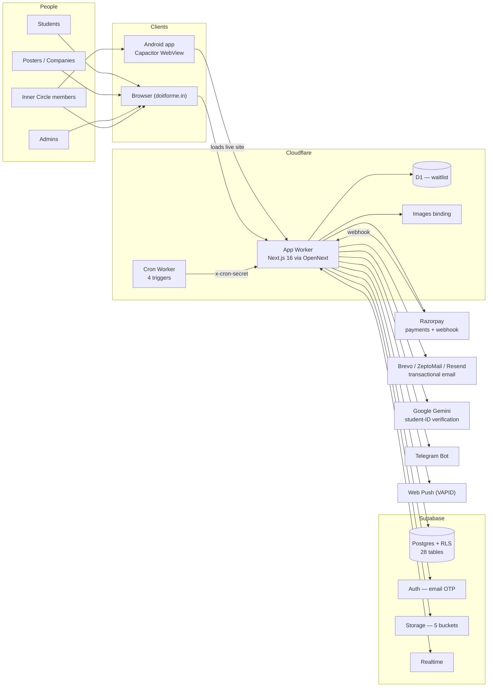
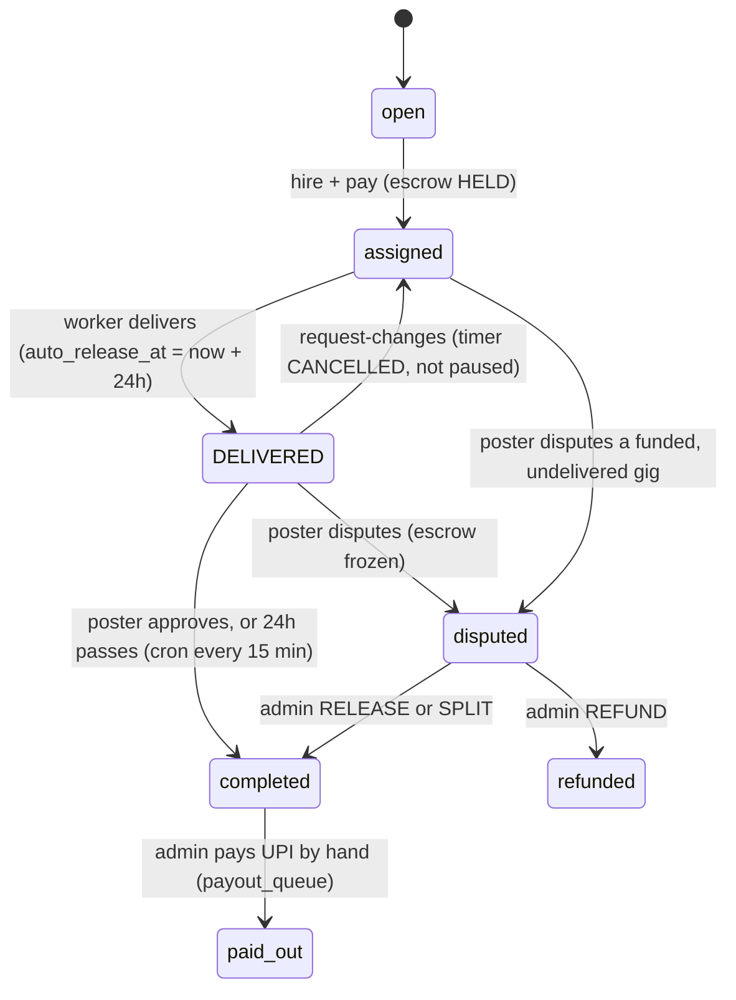

# DoItForMe — High-Level Design

| | |
|---|---|
| **Document** | One-stop description of what DoItForMe is, how it works, and how it is built |
| **Version** | 1.0 — 2026-10-15 |
| **Audience** | Part A: anyone (founders, partners, new joiners, advisers). Part B: engineers |
| **Source of truth** | The code. Where this file and the repository disagree, the repository is right. Every number below was measured on the date shown and says where it came from |
| **Contact** | support@doitforme.in (general) · billing and escalations: gandhimouriyan1234@gmail.com |

**How to read it.** Part A needs no technical background and takes about 10 minutes. Part B is the architecture, layer by layer. The two halves tell the same story at different depths: every box in Part B's diagrams is something Part A describes in words.

---

# PART A — What it is, in plain language

## A1. The 30-second version

DoItForMe is an **Indian platform where students get paid for real work, and nobody gets cheated on either side.**

A company or a person posts a task. A verified student does it. The client's money is **held safely by the platform before work starts** (this is called *escrow*), and it is **released to the student only when the client approves** the result — or automatically 24 hours after delivery if the client says nothing. DoItForMe keeps a small fee (5–10%) for running that safety net.

On top of the open marketplace sits a second, invitation-only layer called the **Inner Circle**: a trained team of students that delivers *larger paid projects* — apps, websites, AI automations — that the parent company **Almmatix** sells to businesses. That is the part being built out now, and it is the part with an Android app.

## A2. Why it exists, and the pivot

Students want to earn. Companies want affordable, reliable help. The gap is **trust**: a company will not pay a stranger upfront, and a student will not work for a stranger who might not pay.

Escrow closes that gap. Money is held before work begins, so the student knows the work is funded, and the client knows nothing is released until they are satisfied. Every completed job also leaves a **dated, client-paid, third-party-verified record** — something a GitHub profile or a CV cannot fake. That record is the platform's real asset and the student's strongest credential.

**The honest history.** The marketplace attracted students easily — about 5,900 accounts — but almost no *buyers*. Of 1,254 tasks posted, only a handful were ever assigned, and the payment ledger shows **43 transactions and about 2 escrow records in total** (queried 2026-10-15). Nothing was broken; there was a supply of people who wanted to earn and no steady demand to employ them. More students could not fix that.

So the model was inverted. **Finding work became the company's job**, not the marketplace's hope: Almmatix sells software services to real businesses off-platform, and hires Inner Circle students *through* DoItForMe to build them. DoItForMe becomes the payment, escrow and tracking layer underneath a managed delivery team.

## A3. Who is involved

| Who | What they do | How they are paid |
|---|---|---|
| **Student** | Applies for tasks, delivers work, builds a verified record | Per task, released from escrow, via UPI |
| **Poster / Company** | Posts tasks, funds escrow, approves the work | Pays the task price (plus a small payment-gateway fee) |
| **Inner Circle — Builder** (`TECH`) | Builds the front end or back end of client projects | Fixed fee per brief, held in escrow first |
| **Inner Circle — Partner** (`OUTREACH`) | Finds companies, opens the conversation, books the first call | Commission: 40% when the client's first payment clears, 60% when the client accepts the work |
| **Project Manager (PM)** | Single point of contact for the client; breaks the project into tasks, hires builders, reviews every delivery, integrates, hands over | A fixed share of the deal (10%) |
| **Admin / Founder** | Joins every first client call, signs the scope, sets prices, resolves disputes, approves members | The company margin |
| **Almmatix** | The parent company that sells the projects and carries the client contract | The margin |

Future Inner Circle roles are already provisioned as "opening next" (QA reviewer, campus lead). Adding a new role such as photography or design is a one-row database change, not a rebuild.

## A4. How it works — three journeys

### Journey 1 — A student earns on the open marketplace

1. A poster publishes a task with a price. Content is screened automatically for phone numbers, UPI IDs and social handles, because taking a deal off the platform is the main way escrow gets bypassed.
2. Students apply. The poster picks one and **pays**. The money is now *held*.
3. The student does the work and submits it. A 24-hour clock starts.
4. The poster approves — or asks for changes in writing (which cancels the clock), or raises a dispute. If they do nothing for 24 hours, the money is released automatically.
5. The student's payout is queued and an admin sends it to their UPI ID.

### Journey 2 — A company hires through DoItForMe's managed service

Same as above, except DoItForMe itself **chooses a vetted student**, checks the quality of the delivery, and stays accountable. Inner Circle students are sorted first for managed work.

### Journey 3 — Almmatix sells a project and the Inner Circle builds it

```
Partner finds a company ─► first call (Admin joins) ─► scope + quote ─► client signs
        │                                                                   │
        │                                                          first payment clears
        ▼                                                                   │
   40% commission                                          Admin hands to a Project Manager
   becomes owed                                                             │
                                                           PM breaks it into tasks & hires builders
                                                           (each task = a real escrowed gig)
                                                                            │
                                                            Builders deliver ─► PM reviews (≤ 1 day)
                                                                            │
                                                        PM integrates & tests ─► client accepts
                                                                            │
                                         60% commission owed ◄───── hand-over + maintenance plan offered
```

Two rules hold this together and are enforced in software, not by good intentions:

- **Nothing is built before the scope is signed and the first payment has cleared.** Under Indian copyright law the author of software owns it unless they assign it in writing. Build first and the client has paid for work whose copyright sits with a student who signed nothing. The terms every member accepts include a written IP assignment for exactly this reason.
- **Every task has exactly one owner and a clock.** "The PM will chase it" is not a process. Each of the 14 steps from "find the company" to "hand over" names one accountable person and a deadline in *working days* (builders are students with classes). The full table is in [OPERATIONS.md](OPERATIONS.md).

## A5. How the money moves

**On a marketplace task** (example: a ₹10,000 task posted by a company):

| | Amount |
|---|---|
| Poster pays the task price | ₹10,000 |
| plus payment-gateway fee (2%, paid by the poster) | ₹200 |
| **Held in escrow** | ₹10,000 |
| DoItForMe fee, taken **from the student's payout** (10% for a company poster, 5% for a student poster) | ₹1,000 |
| **Student receives** | ₹9,000 |

The product always shows students the **net** figure. A student quoted "₹10,000" who receives ₹9,000 has been misled however correct the arithmetic is, so the fee is shown up front.

**On a ₹1,50,000 mobile-app project** (the anchor price):

| Line | ₹ | Share |
|---|---|---|
| Client pays | 1,50,000 | 100% |
| Partner who found the client | 15,000 | 10% |
| Front-end builder | 7,000 | 4.7% |
| Back-end builder (includes testing) | 13,000 | 8.7% |
| Project Manager | 15,000 | 10% |
| Overhead (an AI-assistant seat for the builders, hosting, admin) | 12,000 | 8% |
| **Almmatix margin** | **88,000** | **58.7%** |

DoItForMe's 10% is then deducted from each recipient's payout, so the front-end builder actually receives ₹6,300 and the back-end builder ₹11,700.

**Price list** (set in code in `lib/agency.ts`; an introductory 33% discount applies to the first 10 clients):

| Service | Price (₹) | Typical time |
|---|---|---|
| Mobile app | 1,50,000 | 40 days |
| Web platform | 1,00,000 | 25 days |
| E-commerce | 70,000 | 18 days |
| AI document processing | 60,000 | 15 days |
| Internal tool | 55,000 | 12 days |
| AI assistant | 50,000 | 14 days |
| AI workflow automation | 40,000 | 14 days |
| Marketing site (3 pages) | 30,000 | 10 days |
| Audit | 15,000 | 6 days |
| Landing page | 12,000 | 5 days |

**After delivery — maintenance (AMC).** Clients are offered a monthly plan: 20% of the build price per year in year one (₹2,500/month on the ₹1.5L app, including one new feature a month), then 12% from year two (₹1,500/month). It is pure Almmatix revenue; when something needs fixing, a student is hired for that specific job, with the original builder getting first refusal. Modelled against a realistic year, this keeps about 84% of the plan as margin, versus 32% if a maintainer were kept on a standing share.

**Payouts are manual today.** Indian payout products exclude proprietorships, and DoItForMe is not yet a registered company. An admin sends each payout from a desk in the admin panel. The system queues them and flags anything unpaid after 24 hours. The product deliberately has **no withdrawable wallet** — a balance would be a promise it cannot keep yet.

## A6. How trust and safety work

- **Verification.** Students upload a student ID. An AI model reads it and approves clear cases automatically; unclear ones go to a human review queue. Any kind of student ID is valid (school, college, university, alumni).
- **No self-serve refunds. Anywhere.** Once escrow is funded, money only comes back through a dispute that an admin has reviewed and written a reason for. Outcomes are release, refund, or a **split** (the platform charges its fee only on the portion the student keeps — it does not take a full cut of work it just judged partly unsatisfactory).
- **Content screening** blocks phone numbers, UPI handles and payment keywords in posts and chat, in two layers (pattern rules plus an AI classifier in the browser).
- **Admission to the Inner Circle is earned.** You cannot screen for consistency, only observe it. Applicants do **two paid trial tasks**, the second with unannounced timing; 60 of 100 scoring points go on shipping on time and answering messages, because on a three-week client deal the brilliant developer who goes dark for four days is worse than the adequate one who replies to everything.
- **Information is compartmentalised.** Only the PM (and the admin) can see a project's price *and* what each builder is paid together — that pair is the entire margin. A builder sees their own fee. A partner sees the value of deals they found and nothing about build costs. This is enforced in the database and **tested against the live database** (see B9).

## A7. What the Inner Circle app is

A real phone app (Android now, iPhone later), **not the website in a frame**. It opens on a "Today" screen that answers *what needs me now, and what am I owed*, with four bottom tabs per role:

| Role | Tabs |
|---|---|
| Builder | Today · Briefs · Earnings · Me |
| Partner | Today · Leads · Earnings · Me |
| Project lead / Founder | Today · Projects · Team · Me |

Anyone can download it. **Anyone who is not yet a member sees an application screen instead of a locked door** — what the Inner Circle is, which roles are open, what is opening next, and exactly where their application stands. A download becomes a recruit instead of an uninstall.

## A8. Where things stand today (honest snapshot, 2026-10-15)

| Area | State |
|---|---|
| Marketplace (post → pay → deliver → release) | Built and tested. Plenty of students, almost no buyers: 43 payment transactions lifetime |
| Public site | Live but behind a **maintenance "hold page"**; the landing, pricing and policy pages are reachable (checked by request today) |
| Inner Circle app screens (`/app`) | **Built and committed, not yet deployed.** The live site still answers `/app` with the hold page (HTTP 503) |
| Inner Circle members | **0 approved** and 0 projects in the system — the member experience has not yet been seen by anyone but its builders |
| Android | A debug APK installs today; a Play Store build needs a signing key the owners must create themselves |
| iPhone | Not built. Apple requires its own build tool on a Mac; a rented cloud Mac removes the need to own one |
| Payments | Live with one gateway (Razorpay); payouts to students are manual |
| Error monitoring | **None.** Errors are logged to the console only |
| Legal | Terms and IP assignment are in the product; **a lawyer has not yet reviewed them**. GST registration is not yet required but arrives at ₹20 lakh turnover (about month 5 at three projects a month) |

## A9. Who built it

DoItForMe is built and run by its two co-founders, **Lakshya Betala** and **Mouriyan Gandhi**, with engineering assistance from Claude Code. Almmatix is the parent company that sells the services. The repository history records each change, who authored it and why.

---

# PART B — Technical design

## B1. System context



**One idea runs through the whole design: state is derived, not stored.** There are already three status fields describing a single gig (`status`, `payment_status`, `managed_status`). Adding a fourth that must be hand-synchronised with the money is how a UI ends up reading a stale answer. So new concepts — a builder's workflow step, an application's stage, a commission tranche's paid state, a project's playbook stage — are **computed at read time from facts** (timestamps and the linked gig), never kept in a status column.

## B2. Technology stack

| Layer | Technology | Notes |
|---|---|---|
| Framework | **Next.js 16**, App Router, React 19.2, React Compiler | `proxy.ts` is the middleware (Next 16 renamed it). Built with **webpack** (`--webpack`), not Turbopack |
| Language | TypeScript 5 | Path alias `@/*` → repo root |
| Styling | Tailwind CSS 3.4 + `tailwindcss-animate`; CSS custom properties | Three palettes (B4). Icons: `lucide-react`. Motion: `framer-motion`. Toasts: `sonner` |
| Client state | Zustand (one store, the multi-step post form); otherwise local state and Supabase Realtime | |
| Hosting | **Cloudflare Workers** through `@opennextjs/cloudflare` | Replaced Vercel; main reason: a 15-minute cron the 24-hour auto-release depends on |
| Database / Auth / Storage | **Supabase** (Postgres 17, email-OTP auth, Storage, Realtime) | Row-Level Security on every table |
| Payments | **Razorpay** only | Cashfree was removed; no provider flag by design |
| Email | Pluggable: **Brevo** (300/day free), ZeptoMail, Resend (100/day) | Auto-detected from whichever key is present |
| AI | Google **Gemini 2.5 Flash** (+ Flash-Lite fallback) for ID checks; `@xenova/transformers` zero-shot classifier in the browser for moderation | |
| Notifications | `web-push` (VAPID), Telegram Bot, in-app Realtime toasts, email | |
| Mobile | **Capacitor 7** wrapper (Android generated; iOS pending) | Loads the live site, see B8 |
| Tests | Node test runner + `tsx` (unit), **Playwright** (E2E), live-database audit scripts | B11 |
| Tooling | ESLint 9, Wrangler 4, `pg` for migrations | Node 22+ required; developed on 24 |

## B3. Deployment architecture

```
                    GitHub repo (cloudflare-migration branch)
                                   │  npm run cf:build   (opennextjs-cloudflare build)
                                   ▼
        ┌──────────────────────── Cloudflare ────────────────────────┐
        │  Worker "doitforme1"   .open-next/worker.js                  │
        │    bindings: ASSETS · WORKER_SELF_REFERENCE · IMAGES ·       │
        │              WAITLIST (D1) · var MAINTENANCE_MODE            │
        │                                                              │
        │  Worker "doitforme-cron"   (separate, hand-written)          │
        │    */15 * * * *  → /api/cron/auto-release                    │
        │    30 7 * * *    → /api/cron/nudge-posters                   │
        │    0 9 * * *     → /api/cron/process-payouts                 │
        │    30 3 * * *    → /api/cron/prune-data                      │
        └─────────────────────────────┬───────────────────────────────┘
                                      │ HTTPS
                                      ▼
                     Supabase project (managed Postgres)
```

- **Two Workers on purpose.** `.open-next/worker.js` is regenerated on every build, so a `scheduled` handler there would mean editing generated output. The cron Worker calls the app's own HTTP routes with an `x-cron-secret` header. It targets the `workers.dev` hostname rather than `doitforme.in`, so a DNS or certificate problem takes the website down but cannot silently stop escrow releasing.
- **The hold page** is `MAINTENANCE_MODE` in `wrangler.jsonc` `vars`. `proxy.ts` defaults it **on** (`!== 'off'`) so a missing variable cannot expose a broken site. It is read at runtime — no rebuild to toggle. `/`, `/app` and the policy pages are exempt (`MAINTENANCE_PUBLIC`), and the Razorpay webhook must stay reachable or captured payments are silently dropped when retries expire.
- **Config trap.** `.env.local` is *not* a local file: Next loads it for production builds and OpenNext bakes it into the Worker. Anything production depends on is declared in `wrangler.jsonc` (visible in a diff) or set with `wrangler secret put`; developer overrides go in `.env.development.local`. Cloudflare bindings win over baked values.
- **Size ceiling.** Measured 2026-10-13 with `npm run cf:size`: the Worker script is **3038.66 KiB gzipped against the 3072 KiB (3 MiB) free-plan limit — 33 KiB of headroom**. This fails at *deploy*, not build, so a green `npm run build` proves nothing. Check `npm run cf:size` before adding any server-reachable dependency; put client-only libraries behind dynamic imports.
- **Rollback.** `vercel.json` is kept only so rolling back is a DNS repoint.

## B4. Frontend, layer by layer

**L0 — `proxy.ts` (edge gate).** In order: maintenance rewrite (503 + `Retry-After`) → auth gating for protected prefixes (`/dashboard /profile /post /feed /gig /onboarding /verify-id /messages /activity /payouts /settings /admin /inner-circle /program /app`) → bounce signed-in users off `/login`. Auth is checked only where it changes the answer, because `getUser()` is a network call.

**L1 — Root layout.** Fonts (Space Grotesk for display, Inter for body), metadata and Organization JSON-LD, the global `RealtimeListener` (extend it — do not add a second), `NativeShell` (renders nothing on the web), toasts, and `viewportFit: "cover"` (load-bearing: without it every `env(safe-area-inset-*)` is `0px`). Error boundaries: `app/error.tsx` for route throws, `app/global-error.tsx` for root-layout throws (inline styles only, because the stylesheet lives in the layout that failed).

**L2 — Route families (53 pages).**

| Family | Examples | Shell / palette |
|---|---|---|
| Public | `/`, `/pricing`, `/terms`, `/privacy-policy`, `/refund-policy`, `/contact`, `/talent`, `/u/[username]`, `/login` | Dark, no shell |
| Workspace (signed-in) | `/dashboard /feed /gig/[id] /activity /messages /payouts /profile /settings /inner-circle /program` | Cream palette inside `AppShell` (sidebar, mobile nav, topbar) |
| Company | `/company/*` | B2B funnel; companies need admin clearance |
| Admin | `/admin` | Tabs: Payouts, Disputes, Managed Queue, Companies, Pending Companies, Student IDs, Inner Circle, Broadcast |
| **Inner Circle app** | `/app`, `/app/briefs`, `/app/earnings`, `/app/leads`, `/app/projects`, `/app/team`, `/app/me` | Near-black `.icapp` palette, bottom tabs, one column |

**L3 — Components.** `components/ui/` (Avatar, Card, Button, StatusBadge, Modal, Skeleton, EmptyState), `components/shell/` (navigation is declared only in `nav.ts`), `components/app/` (BottomTabs, JoinScreen, app UI kit), `components/home/`.

**L4 — Design system: one token contract, three palettes.**

| Palette | Where | Why distinct |
|---|---|---|
| Dark `#0B0B11` (Swiss-minimal, purple accent) | public pages | Marketing surface |
| Cream workspace (`.workspace`, `workspace-theme.css`) | signed-in website | Built for a wide desktop rail and a topbar |
| Near-black `#07070B` (`.icapp`, `app-theme.css`) | `/app` | OLED phone; **one** accent, **one** gradient, and a dedicated gold used for money *only* so an amount is never mistaken for a status chip |

Components name token **roles** (`--fg`, `--surface`, `--line`, `--accent`, `--on-accent`), never colours, so the same class resolves correctly in each palette. `--on-accent` exists because a global `text-white → text-[var(--fg)]` sweep once turned the primary escrow button into dark violet on violet.

## B5. Backend, layer by layer

```
Route handler (app/api/**/route.ts)      54 handlers
   │  authenticate FIRST, then validate input (401 before 400)
   ▼
Domain modules (lib/)                    pure, unit-tested
   │  fees · gigRoles · agency · operations · innerCircle · access · appShell · programTerms · …
   ▼
Supabase client (one of three)           RLS-respecting by default
   │  browser / server (cookie) / service-role (inline, server only)
   ▼
Postgres: tables + RLS + SECURITY DEFINER RPCs
```

| Area | Handlers | Responsibility |
|---|---|---|
| `gig/*` (14) | apply, hire, hire-direct, deliver, complete, request-changes, dispute, accept-offer, reject-offer, request-service, handshake, rate-poster, report, delete | Whole gig lifecycle |
| `admin/*` (10) | resolve-dispute, assign-managed, review-kyc, inner-circle, probation, outreach/commission, … | Admin desk. New routes use `requireAdmin()` |
| `payments/*`, `webhooks/razorpay`, `escrow/release` | create-order, verify-payment, webhook, release | Money in and release |
| `cron/*` (4) | auto-release, nudge-posters, process-payouts, prune-data | Scheduled jobs, secret-gated |
| `company/*`, `profile/*`, `auth/*`, `kyc/upload`, `program/terms`, `push/*`, `telegram/*`, `referral/*`, `recommend`, `moderation`, `chat`, `account`, `waitlist` | | Supporting features |

Three Supabase clients, chosen deliberately: **browser** (RLS via the user's session), **server** (cookie store, RLS), and **service-role** built inline only inside route handlers, never reachable from the browser bundle. `requireAdmin()` constructs the service-role client **only after** the whitelist check passes — built first, it is one early return away from a handler that bypasses RLS for anybody.

**Domain modules worth knowing** (`lib/`):

| Module | Owns |
|---|---|
| `fees.ts` | The only place percentages live: `PLATFORM_FEES` (student 5%, business 10%), gateway 2%, `platformFeeFor()` (rounds **up**, so not algebraically invertible) |
| `gigRoles.ts` | The only answer to "who pays, who is paid" — **one** money direction |
| `agency.ts` | Service catalogue, `DEAL_SPLIT`, `quoteFor()`, AMC model, founding discount, GST runway |
| `operations.ts` | The 14-step pipeline: owner, working-day clock, exit test, proving fact |
| `innerCircle.ts` | Roles, `workflowFor()`, `applicationStage()`, outreach stages |
| `appShell.ts` | Who may use the app, derived role, tabs |
| `access.ts` | The access matrix that the live-DB audit proves |
| `programTerms.ts` | Versioned clauses; `TERMS_VERSION` |
| `paymentSettlement.ts` | The single settlement implementation, reached by webhook *and* browser callback |
| `kycVerification.ts`, `moderation*.ts`, `email.ts`, `push.ts`, `telegram.ts` | Integrations |

## B6. Data layer

**28 tables, all with RLS enabled; 26 public functions; 68 migrations; 5 storage buckets** (queried 2026-10-15).

| Domain | Tables |
|---|---|
| Identity | `users` (+ `my_profile` view), `wallets`, `referrals`, `ratings`, `reports` |
| Marketplace | `gigs`, `applications`, `messages`, `notifications`, `gig_alerts_sent`, `recommendations` |
| Money | `transactions`, `escrow`, `escrow_events`, `payout_queue`, `disputes`, `points_transactions` |
| Companies | `companies` |
| Inner Circle | `inner_circle_roles`, `inner_circle_applications`, `outreach_leads`, `outreach_touches`, `outreach_commissions`, `program_term_acceptances`, `program_probation_tasks` |
| Agency delivery | `projects`, `project_tasks` |
| Delivery infra | `push_subscriptions` |
| Cloudflare D1 | `waitlist` (signups captured during the hold page) |

Scale as queried: ~5,900 users, 1,254 gigs, 2,271 applications, 43 transactions, 1,099 ID-approved users, ~273k notification rows (pruned by the nightly cron — this table is the first to grow without bound).

**Storage buckets.** `kyc-ids`, `resumes`, `verification-docs` are **private**; `gig-images` and `chat-attachments` are public (gig photos must be). Resumes store a bare object path and are read through `/api/profile/resume`, which authorises (self / admin / a poster the student applied to) and mints a 5-minute signed URL.

**Key RPCs.** `manual_release_escrow` (the *only* release path: it locks the HELD escrow row against double payout, refuses if the worker has no UPI, and inserts the `payout_queue` row), `release_escrow_transactional`, `refund_escrow_transactional`, `freeze_/unfreeze_wallet_amount`, `increment_worker_stats`, `is_admin()`, `is_outreach()`, `is_project_pm()`, `has_accepted_terms()`, `is_kyc_approved()`, `prune_notification_tables()`.

**Integrity rules written into the schema:**

- `projects_gates_in_order` (CHECK): a project cannot be accepted before its scope is signed, handed over before accepted, and so on. Written with explicit NULL handling because *a CHECK that evaluates to NULL passes*.
- `project_tasks_one_per_gig` (unique): one gig pays one task — two would double-count progress and money.
- `outreach_commissions(lead_id, tranche)` unique, `tranche ∈ {'first','final'}` — raising a tranche twice is a no-op, not a second payment.
- `gigs_service_advert_never_assigned`: a `SERVICE` advert can never be assigned or funded.
- `kyc_verified = (kyc_status = 'approved')` enforced by CHECK, after the cached boolean was found drifting.
- No status column on `projects`, `project_tasks`, `outreach_commissions` or `program_probation_tasks` — see the derived-state principle in B1.

## B7. Core domain — the gig and the money



**Listing types.** `HUSTLE` and `COMPANY_TASK` are tasks (the assigned worker is the payee). `SERVICE` is a *shopfront advert, not a transaction* — it can never hold escrow; hiring from it creates a normal engagement via `/api/gig/request-service`. `MARKET` belongs to the sister marketplace (marketforme.in) and has zero rows here.

**Payment path.** Two entry points create orders and must stay in step: `payments/create-order` (fund an assigned gig) and `gig/hire` (hire-and-pay in one step). Both **re-fetch the real price from the database and ignore any amount in the request body**. Settlement has one implementation, reached by the Razorpay webhook (survives a closed tab; refuses to run at all without `RAZORPAY_WEBHOOK_SECRET`) and the browser callback; both are idempotent — the transaction row is claimed with a conditional UPDATE and only the winner funds escrow. Verification needs two checks: the HMAC proves the callback is genuine, and re-reading the payment proves it was `captured`.

**Fee audience.** `audienceForGig()` returns BUSINESS when `company_id` is set or the listing is a `COMPANY_TASK`, else STUDENT. The create-order route stores the full breakdown in `transactions.provider_data.breakdown`, and the cron prefers that **stored** fee, so historical gigs keep the rate they were priced at when the dial moves.

**Disputes.** `/api/admin/resolve-dispute` implements RELEASE (identical arithmetic to the cron), REFUND (delegates to `refund_escrow_transactional`) and SPLIT (platform fee only on the portion the worker keeps). Decision notes are mandatory and emailed to both sides; that text is the record if a payment is ever charged back. The tab badges anything past the 48-hour SLA.

**Ratings are two-sided and kept apart.** A rating whose gig the rated person owns is a *poster* rating; the rest are *hustler* ratings. `users.rating` stays the hustler score.

## B8. The agency program and the Inner Circle app

**Roles and entry.** `users.inner_circle_role ∈ {TECH, OUTREACH}` plus `is_elite`. Approval (`/api/admin/inner-circle`) writes the **user row first** — a half-failure then leaves a member whose application reads pending (visible) rather than an approved application with no access (looks like it worked). It also **refuses to approve anyone who has not accepted the current terms** for that role. `/api/program/terms` records acceptance with IP and user-agent, which is why it is a route and not a browser write: two of the three evidentiary columns cannot be collected client-side honestly.

**Probation.** `program_probation_tasks`: two paid rounds, posted as *real gigs* so the applicant's first payment is the genuine flow. Round 2 cannot be sent until round 1 is scored. `SCORECARD` weights: on-time 40, responsive 20, asked questions 15, ran the thing 15, craft 10; pass mark 70. A test asserts someone who missed the deadline cannot pass on the other four combined.

**Operating model as code.** `lib/operations.ts` holds the 14-step pipeline (find → contact → chase → meeting → quote → contract → deposit → assign → staff → build → review → integrate → accept → handover). Constraints it encodes and tests: contract before staffing; deposit before hiring; the PM review SLA is **1 working day because escrow auto-releases in 24 hours** (a longer SLA lets money leave unreviewed); a builder's clock is `project_tasks.due_on`, never `gigs.auto_release_at`; builders are nudged at 60% elapsed; two projects per PM with over-cap leads queued and commission locked to the finder. Readable version: [OPERATIONS.md](OPERATIONS.md).

**Attribution.** The end client never transacts on DoItForMe, so every gig's `company_id` is Almmatix and nothing can infer which lead produced which project through the obvious chain. `outreach_commissions` is the missing edge.

**The app surface (`/app`).** `lib/appShell.ts` resolves a role with precedence **ADMIN > PM > TECH/OUTREACH**, all derived: admin = email whitelist, PM = owns a `projects` row, member = `is_elite` + role. `app/app/layout.tsx` is a **server component** gate — a client check would ship the surface and hide it with CSS, which is a curtain, not a gate. Non-members get `JoinScreen`: open roles with seat counts, planned roles, a link to apply, or the four-stage progress of an existing application. `/app/loading.tsx` provides a skeleton for every tab. The role registry (`inner_circle_roles`, `status ∈ open|planned|closed`) means growing the roster is one INSERT.

**Capacitor (Android).** The wrapper loads the live site over HTTPS rather than a static export, because half of this product is server-rendered and every signed-in route is dynamic; a static export would need a second client-only app and two sets of auth bugs. Consequences: no offline beyond the service worker; **a site deploy reaches the app instantly with no store review**; Apple guideline 4.2 rejects pure website wrappers, so iOS needs native push, camera and share targets before submission. Native details: branded adaptive icon and splash at every density; the Android 12+ splash theme (the bitmap alone is ignored on API 31+); `androidScheme: "https"` (otherwise Secure auth cookies are dropped); `NativeShell` wires the hardware back button to history, themes the status bar, hides the splash after hydration (4-second ceiling), and routes `/` to `/app`. The build needs **JDK 21** (Capacitor 7), available inside Android Studio. Release signing reads a gitignored `android/keystore.properties`; **the upload key is deliberately not generated by any script** — Google pins the app id to its signature, so losing it means the listing can never be updated.

## B9. Security model

| Control | How |
|---|---|
| Row-level access | RLS on all 28 tables. Policies key off `auth.uid()`, `is_admin()`, `is_outreach()`, `is_project_pm()` |
| Column-level access | RLS cannot hide a column, so `anon` has `SELECT` only on a named safe-column list for `users` and `gigs`; a column added later is private by default |
| Function exposure | Every `SECURITY DEFINER` function: `REVOKE ALL … FROM PUBLIC, anon, authenticated`, then `GRANT` to `service_role`. Supabase grants `EXECUTE` to `anon` *directly*, so revoking from `PUBLIC` alone is half a fix. Verified with `has_function_privilege` |
| Admin identity | Email whitelist in **two** places — `lib/admins.ts` and SQL `is_admin()` — because RLS cannot import TypeScript. Edit both together |
| Authenticate before validate | Anonymous callers get 401, never a field-validation 400 that reveals the endpoint is open |
| Money integrity | Amounts re-fetched server-side; idempotent settlement; webhook signature + captured re-check; one release function; no self-serve refund |
| Uncalled routes | An unused `route.ts` is still a public endpoint — four dangerous ones were deleted and `route-surface.test.mjs` now pins the surface |
| Privacy | KYC, resumes, verification docs in private buckets; contact details of third-party companies readable only through `is_outreach()` / `is_admin()` |
| Secrets | Service-role key and webhook secret only server-side; `CRON_SECRET` gates every cron route |
| Evidence | Terms acceptance stored with IP and user-agent; dispute decisions stored and emailed |

**Proven, not claimed.** `npm run db:anon-audit` (49 checks) fails when anything private is readable with the public anon key. `npm run db:access-audit` (29 checks) **becomes each role in the live database** — by setting `request.jwt.claims` and switching to `authenticated`, exactly what PostgREST does — and counts the rows that come back. It proves a builder cannot read a deal value, outreach cannot read build costs, nobody outside PM/admin holds both, one partner cannot read another's project, and a PM cannot create a project. It uses disposable rows and deletes them.

## B10. External integrations

| Service | Purpose | Failure behaviour |
|---|---|---|
| **Razorpay** | Orders, checkout, webhook | Webhook refuses to run unverified; browser callback races it by design |
| **Supabase** | Postgres, Auth (email OTP only), Storage, Realtime | Free tier; ~1 GB storage is the nearest ceiling |
| **Cloudflare** | Workers, D1, Images, DNS | Worker size ceiling (B3); 15-min cron |
| **Brevo / ZeptoMail / Resend** | 19 transactional templates, fire-and-forget | A 429 is logged as `DAILY SEND CAP REACHED`; Brevo's 300/day cap is why a mass announcement must be batched |
| **Google Gemini** | Student-ID verification | **Fails open** to `manual_review`; the free tier is 20 requests per model per *day*, so `KYC_MODELS` cascades to a second model. `KycResult.failure` distinguishes a dead service from a genuinely unclear ID |
| **Telegram Bot** | Instant alerts, linked via `/start` | Optional channel |
| **Web Push (VAPID)** | Browser notifications | `PUSH_DISPATCH_SECRET` gates dispatch |
| **Google Workspace** | `support@doitforme.in` mailbox (MX) | Reply-To for all transactional mail; mail is **sent** from `noreply@` |
| **Capacitor / Android SDK** | Native wrapper, JDK 21 | Debug APK installable; release needs a key |

**Email authentication (DNS, at Cloudflare).** Brevo DKIM is published. SPF must be a *single* merged record covering Google, Brevo and any other sender — a second SPF record is a permanent error — and DMARC should stay at `p=quarantine` until SPF is confirmed passing. Do not adopt a registrar-supplied SPF that names only one provider.

**Environment variables read by the code** (names only; values live in Cloudflare secrets or `wrangler.jsonc`): `NEXT_PUBLIC_SUPABASE_URL`, `NEXT_PUBLIC_SUPABASE_ANON_KEY`, `SUPABASE_SERVICE_ROLE_KEY`, `RAZORPAY_KEY_ID`, `RAZORPAY_KEY_SECRET`, `NEXT_PUBLIC_RAZORPAY_KEY_ID`, `RAZORPAY_WEBHOOK_SECRET`, `CRON_SECRET`, `GEMINI_API_KEY`, `TELEGRAM_BOT_TOKEN`, `EMAIL_PROVIDER` plus one of `BREVO_API_KEY` / `ZEPTOMAIL_TOKEN` / `RESEND_API_KEY`, `NEXT_PUBLIC_VAPID_PUBLIC_KEY`, `VAPID_PRIVATE_KEY`, `VAPID_SUBJECT`, `PUSH_DISPATCH_SECRET`, `MAINTENANCE_MODE`.

## B11. Testing and quality gates

| Gate | Command | Count / scope |
|---|---|---|
| Unit | `npm run test:unit` | **164 tests, 16 files** — fees, money, gig roles, disputes, payouts, KYC decision, agency pricing, operations, app shell, terms, route surface, Cloudflare/Vercel config, Razorpay, moderation |
| E2E | `npm run test:e2e` | Playwright, Chromium: golden path, responsive, smoke, UAT-readiness |
| Escrow money movement | `npm run test:escrow` | Asserts across three tables with disposable rows — unit tests cannot catch this class of bug |
| Service-request schema | `npm run test:service-request` | Live-schema check that hiring from an advert builds a valid engagement |
| Constraint audit | `npm run db:audit` | 8 constraints the code relies on, confirmed present |
| Anon exposure | `npm run db:anon-audit` | 49 checks, inverted assertion |
| Access matrix | `npm run db:access-audit` | 29 checks against live RLS |
| Bundle size | `npm run cf:size` | Run before any dependency change |

`npm run test:unit` enumerates files explicitly. `tsx --test tests/unit/` silently skips `.ts` files, and two suites once sat unexecuted while reporting green.

## B12. Runbooks

```bash
# Local
npm run dev
npm run build            # webpack
npm run lint             # 2,206 pre-existing errors; hold the number, do not add to it

# Database
npm run db:migrate supabase/migrations/<file>.sql    # idempotent files; verify afterwards
# then: db:audit, db:anon-audit, db:access-audit

# Cloudflare
npm run cf:size          # MUST be < 3072 KiB gzipped
npm run cf:deploy        # app Worker
npm run cf:deploy:cron   # cron Worker
npm run cf:secrets       # set secrets

# Android (JDK 21)
npx cap sync android
cd android && JAVA_HOME="C:/Program Files/Android/Android Studio/jbr" ./gradlew assembleDebug
# regenerate launcher icons + splash:  node scripts/make-android-icons.mjs
```

## B13. Known risks and technical debt

| # | Item | Severity | Note |
|---|---|---|---|
| 1 | **Nothing from the Inner Circle build is deployed** | High | Live `/app` returns the hold page; all judgement of the app so far is of code never shipped |
| 2 | Worker at 98.9% of its size limit | High | 33 KiB headroom (measured 2026-10-13); fails at deploy time |
| 3 | No error monitoring | High | Boundaries log a `digest` to the console; nothing aggregates it |
| 4 | 0 Inner Circle members, 0 projects | Medium | The member surfaces are unexercised with real data |
| 5 | ~273k rows in `notifications` | Medium | Pruned nightly; the first table to grow without bound |
| 6 | Storage near the 1 GB free ceiling | Medium | ~335 MB/month growth when last measured — **re-measure**; Cloudflare R2 offload planned but not enabled |
| 7 | 2,206 lint errors (mostly `any`, unescaped apostrophes) | Medium | Pre-existing; the count is the baseline to hold |
| 8 | Mixed-case status vocabulary (`open`, `assigned`, `completed` vs `DELIVERED`) | Low | Legacy; normalising casually would break comparisons |
| 9 | Terms and IP assignment not lawyer-reviewed | High before scale | `IP_ASSIGNMENT` is the clause that can void a paid deal |
| 10 | GST | Planned | ₹20 lakh turnover, PAN-wide; confirm timing with a CA |
| 11 | Manual payouts | Accepted | Needs a registered entity for RazorpayX |
| 12 | Hiring rounds are not yet modelled | Planned | See B14 |

## B14. Roadmap — recommended order

1. **Deploy** the committed work (`npm run cf:size` first). `/app` is exempt from the hold page, so members get the app while the public site stays held.
2. **Create one member of each role** so the Builder and Partner surfaces can be seen with real data.
3. **Judge the app on a physical phone**, then do a targeted UX pass on what is actually wrong.
4. **Flexible hiring rounds.** A round is `{order, type, label, url, note}` with `type ∈ form | sheet | meet | chat | gig`. The external tool (a Google Form, a sheet, a Meet, a Discord or Slack invite) holds the data; the app holds only the *position in the sequence* and an admin advances people. Paid trial gigs and terms acceptance stay on-platform: escrow and the verified record are the moat, and acceptance needs IP and user-agent as evidence.
5. **Announce** to existing users in batches under the daily email cap, after step 1.
6. Error monitoring; storage offload; iOS via a cloud macOS runner; lawyer review; Play Console listing.

## B15. Key decisions and why

| Decision | Reason |
|---|---|
| Capacitor, not Flutter / React Native | No framework reaches iOS without Xcode. A rewrite is 46+ screens, two palettes, auth, escrow, KYC and chat, maintained beside the website, for zero iOS gain |
| Cloudflare Workers, not Vercel Hobby | Hobby crons are daily and hour-accurate; the 24h auto-release needs 15 minutes |
| Razorpay only | One gateway is the point; Cashfree never cleared marketplace onboarding |
| Supabase Auth stays (email OTP) | Auth is not a billed dimension on the free tier; custom passwords add a permanent security surface on a product that moves escrow money |
| Fee deducted from the recipient | Almmatix pays gross; the product only ever shows net |
| Flat deal split, not tiered | A flat share pays a similar day-rate at every price; tiering paid different rates for the same work |
| Derived state | A second state machine beside the money is the one that goes stale, and the UI always reads the stale one |
| Two tables for projects | Different policies per table is how "only the PM sees price and cost together" becomes enforced rather than intended |
| `/app` is a separate surface | The marketplace is web-shaped; the Inner Circle is app-shaped |
| App is open to download | Downloads are the point; a non-member sees an application funnel, never a locked door |
| No self-serve refund | Escrow's promise depends on it; money returns only through an admin-reviewed dispute |

## B16. Glossary

| Term | Meaning |
|---|---|
| **Almmatix** | Parent company that sells services to businesses |
| **Inner Circle** | Invitation-only delivery team, entered through two paid trial tasks |
| **Builder / Partner** | Inner Circle roles `TECH` / `OUTREACH` |
| **PM** | Project Manager: the client's single point of contact; owns a project's delivery |
| **Brief** | A unit of work assigned to a builder, always backed by a funded gig |
| **Escrow** | Client's money held by the platform until approval or 24h of silence |
| **Tranche** | One instalment of a partner's commission (`first` 40%, `final` 60%) |
| **AMC** | Annual maintenance contract — the monthly care plan sold after delivery |
| **Hold page** | The maintenance page shown while `MAINTENANCE_MODE` is on |
| **RLS** | Row-Level Security: the database itself decides which rows a caller may read |
| **Net / gross** | What the recipient receives / what the payer funds |
| **Derived state** | A value computed on read from facts rather than stored in a column |

## B17. Repository map

```
app/            Next.js routes (53 pages, 54 API handlers); app/app/ is the Inner Circle app
components/     ui/ · shell/ · app/ · home/ · NativeShell.tsx
lib/            Domain logic and integrations (list in B5)
proxy.ts        Edge middleware: maintenance, auth gate
supabase/migrations/   68 dated SQL files (trust these, not supabase/README.md)
workers/cron/   The scheduled-jobs Worker
android/        Generated Capacitor project (signing key NOT committed)
scripts/        Migration runner, audits, icon generation, maintenance
tests/          Playwright specs + tests/unit/
docs/           APP.md (mobile runbook) · OPERATIONS.md (pipeline) · HLD.md (this file)
CLAUDE.md       Engineering notes and the traps that have already bitten
CLOUDFLARE.md   Deploy runbook
```

*Related documents:* [APP.md](APP.md) · [OPERATIONS.md](OPERATIONS.md) · [../CLOUDFLARE.md](../CLOUDFLARE.md) · [../CLAUDE.md](../CLAUDE.md)
